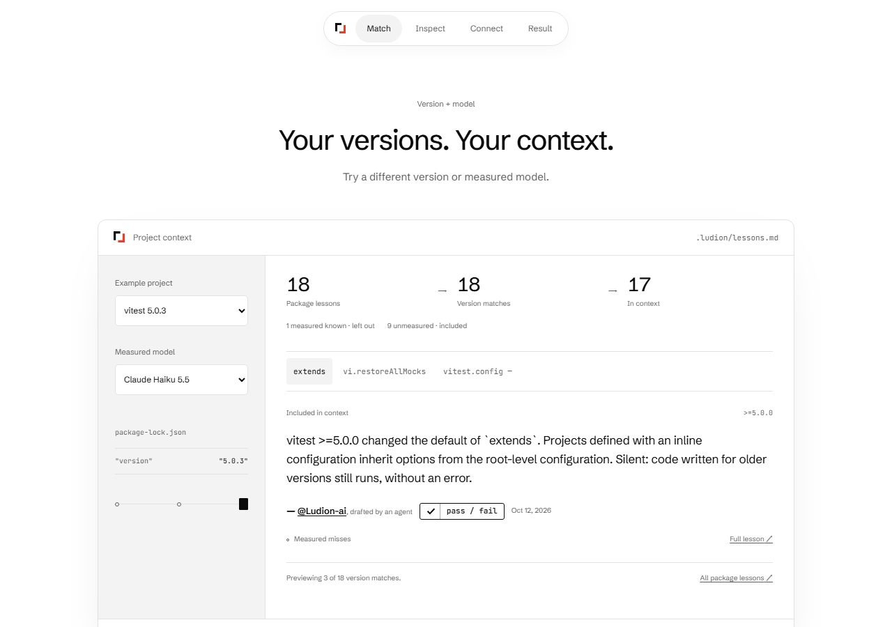
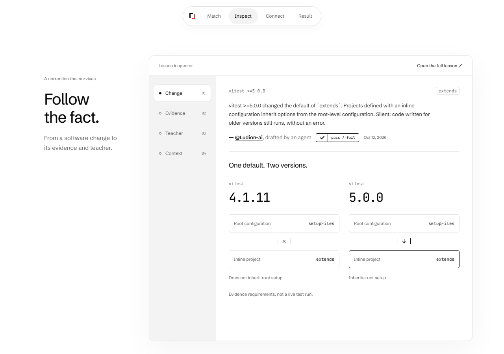
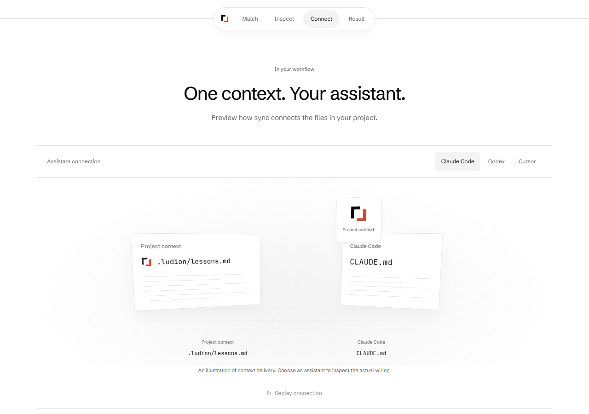

# Home: an explorable product story — 2026-10-14

The homepage now shows Ludion's benefits through controls and actual product data. The opening retains the approved context-plane composition and supplied bracket mark. Scrolling reveals matching, an evidence inspector, assistant delivery, the existing recorded answer comparison and setup. A small native chapter navigator connects them. This supersedes the earlier local-only home-showcase candidate; its historical captures and receipts remain intact.

## What the screens establish

- **Match:** example installed versions and measured models use the CLI's actual `matchingVersions` and `select` functions at build time. Only measured `knows` verdicts are pruned; missing measurements stay included. The default Haiku example makes pruning visible. Counts describe all matching lessons; the small preview is labeled separately. It reads no visitor project files. Claims, numeric teacher identity, agent-draft labels, evidence labels and full lesson URLs come from the active index.
- **Inspect:** the actual immutable `extends` lesson is explored through Change, Evidence, Teacher and Context. The claim and signature remain visible across steps. Exact differential pins and expected errors describe evidence requirements, not a new test run. The source quotation remains literal and linked. Context shows the real recorded sync excerpt with its original date, complete-record lesson count and uncovered-dependency scope. With no JavaScript every step remains accessible.
- **Connect:** Three.js CSS3D projects real DOM objects for the context file and the selected assistant. A finite delivery illustration and pointer depth show the connection. Native controls below it show the real CLI contracts: Claude imports context and may create its file; Codex adds a reference only when `AGENTS.md` exists; Cursor writes its complete inline rule only when `.cursor` exists. The illustration runs no CLI, writes no files and calls no model. Flat labels remain readable outside the 3D projection. Replay retains keyboard focus; reduced motion and hidden/offscreen state stop movement. There is no idle animation loop.
- **Result:** the earlier literal recorded comparison retains its model, question, installed version, frozen scope, one-trial qualification, full answers and record URL. It remains independently available on Bench. Neither matching nor the illustration is presented as a live benchmark or proof that a single lesson caused the recorded answer.

The evidence scene uses an asymmetric desktop composition, followed by the wider delivery scene, to avoid repeating one card layout throughout. Mobile uses ordinary stacked content and native controls. Stable grids reserve the largest case/step so selection does not jump the page. Existing URLs, `#replay`/`#recent`, attribution, privacy, partial coverage and license disclosures remain. The opening's wave still reaches the top and retains its previous lower-bound and raster-budget formulas.

## Validation and review

The measured commands, outcomes, asset/source hashes and normal-motion capture profiles are in [the validation receipt](../bench/2026-10-14-home-app/validation.json). Checks include the actual-page browser suite, all-page reflow and accessibility in both themes, version/model pruning, no-JavaScript fallback, keyboard/focus, clipboard bytes, reduced motion, offscreen termination, wave contrast/bounds and the existing JavaScript budget. Sample pages are built separately and never deployed.

An independent actual-image/source review found the initial all-equal matching counts and repeated large-card composition weak; the default model and scene layouts were changed. The review measured unreadable projected file labels on a phone; flat labels were added and the delivery packet was moved above the names. A broader state accessibility sweep found a small link too close to the sticky navigator after scrolling. Its target was enlarged, and a regression test now scans Evidence/Cursor states in both mobile themes. Narrow model selectors were stacked to keep full names visible.

## Dependency and measurement limits

Three.js is pinned in the site package, with its MIT notice served at `/licenses/three.txt`. Only that package was added to the lockfile; no existing version changed. The existing npm audit findings concern two pre-existing advisories, represented by seven package entries, not a new Three.js finding: [MCP OAuth client](https://github.com/modelcontextprotocol/typescript-sdk/security/advisories/GHSA-6qxp-vccf-f47h) and [Sharp](https://github.com/lovell/sharp/security/advisories/GHSA-wq5f-xc86-pv6w). The reviewed Worker path uses the MCP server, not the affected OAuth client path; Sharp is present in the build/local-development toolchain, not the Worker bundle. This is a bounded dependency-path review, not a general security clearance. No unrelated dependency upgrade was folded into a homepage release.

CSS3DRenderer's documented browser/display zoom restriction applies to the decorative projection; essential content and controls are native DOM outside it. Real-device frame rate, visitor comprehension, conversion and competitive motion polish have not been measured. Small metadata and repeated claim context remain candidates for subsequent user observation. No paid API runs, new accounts, copied competitor assets/code or local execution of lesson code occurred.

## Actual build captures

[Mobile matching](2026-10-14-home-app/match-320-light.png) · [Mobile connection](2026-10-14-home-app/connect-320-dark.png)
