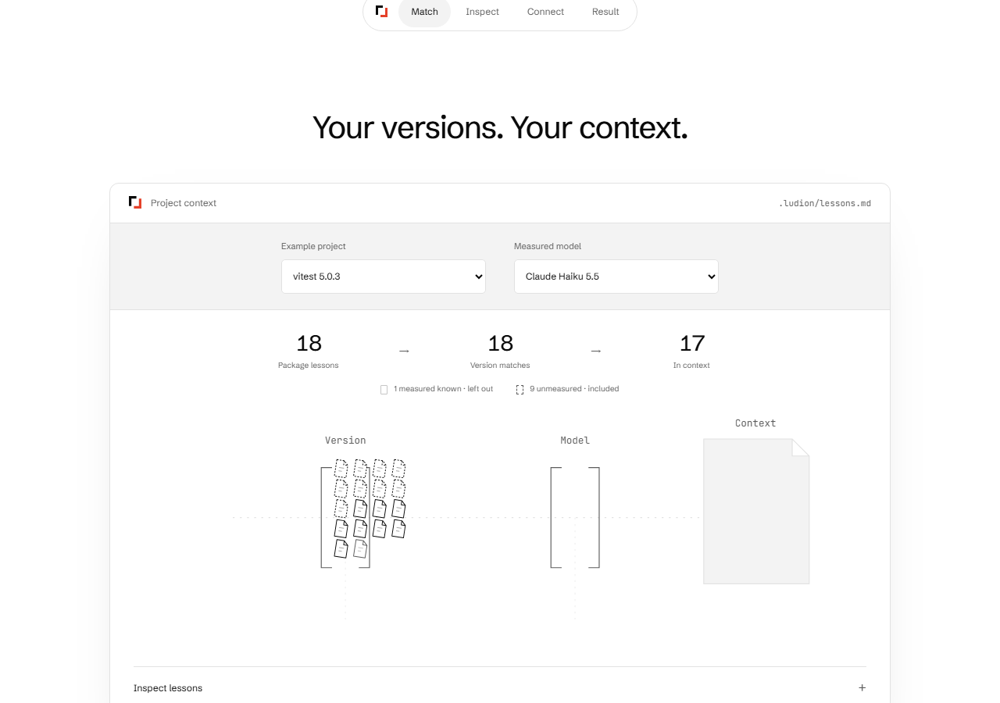
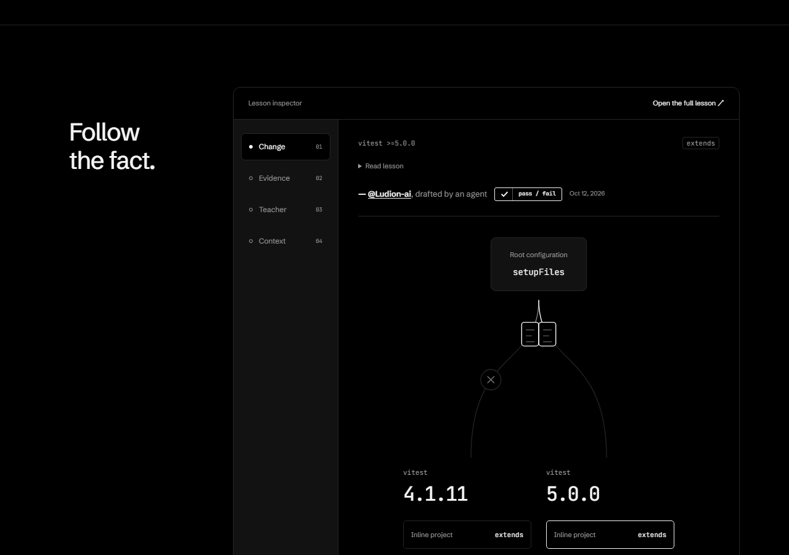
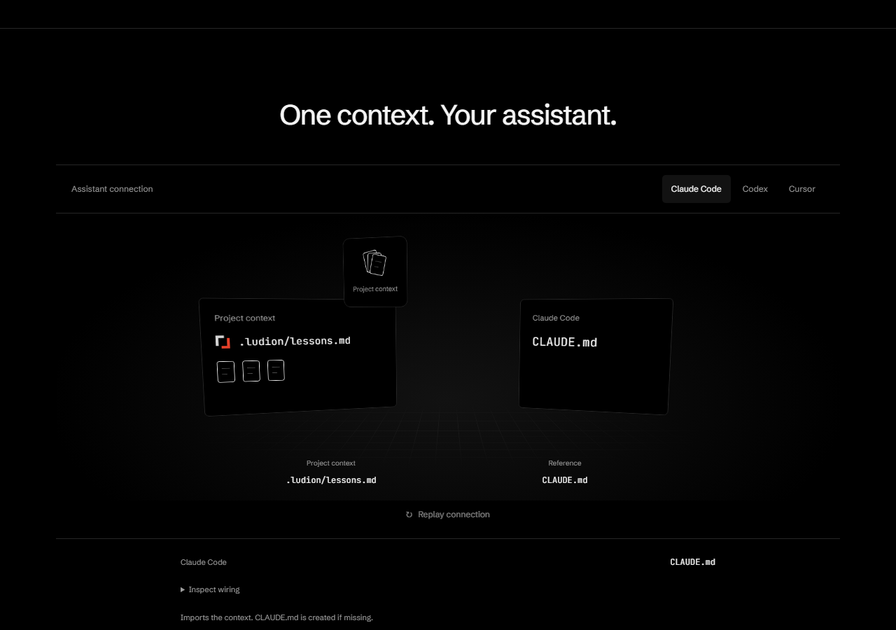

# Home: graphics before explanation — 2026-10-14

The owner clarified that the next homepage improvement means more shapes and movement, with fewer words. The approved opening stays unchanged. The following scenes now demonstrate selection, inheritance and delivery as finite graphic sequences; full claims and wiring remain available through native disclosures.

## What changed

**Match:** anonymous paper tiles represent every active package lesson in the current example. Their version/model exits come from the CLI's actual selection, rather than a second visual approximation. Measured known lessons exit; unmeasured lessons remain in context. Native counts and the legend stay visible. The generated lesson preview, teacher identity, agent-draft label and original URLs are reachable under Inspect lessons. The desktop route is horizontal; the mobile route is compact and vertical.

**Inspect:** a single root configuration branches into the actual differential version pins. The older branch stops; the current branch reaches the inline project. This illustrates the recorded evidence requirements, not a new test run. The full generated claim is under Read lesson; the teacher signature and draft label remain visible. Exact source quotations, expected errors, recorded context and dates remain available through the existing controls.

**Connect:** the existing Three.js scene now transports paper shapes and reveals the destination's actual delivery mode: Reference for Claude Code/Codex and Inline context for Cursor. These shapes illustrate context, not a lesson count. Flat labels remain readable outside perspective. Inspect wiring exposes the unchanged conditional file contract and literal code. The illustration runs no CLI, writes no visitor files and calls no model.

Repeated section subtitles and eyebrow labels were deleted. The chapter navigator is static: an expanded-state accessibility check found that its former sticky position covered a source link. Native anchors still navigate between the scenes. The wave and its top/lower bounds are unchanged. No dependency was added.

## Validation

The measured receipt is [validation.json](../bench/2026-10-14-home-motion/validation.json). Its text comparison uses a fresh default desktop load before scrolling and counts `main.innerText` split on whitespace. It includes option text and accessible captions; it is a DOM-text measure, not evidence of comprehension or conversion. Full claims are retained, not shortened into new claims.

Meaningful browser checks cover paper populations against the public shards, measured-known pruning, unknown inclusion, movement followed by settling, offscreen/hidden termination, reduced motion, keyboard focus, literal wiring/clipboard bytes, no-JavaScript disclosures, stable selection height and expanded-state WCAG checks in both themes. The initial full sweep exposed a test fixture race: its mock clock advanced before the browser's media-change notification. Waiting for the actual media and stopped state fixed the ordering while preserving the movement assertions. Source behavior was unchanged.

Independent source, actual-image and live interaction review found the initial mobile route too tall and projected delivery-mode text too small. The route was shortened, its legend moved beside the counts, and the mode added to the flat label. The final review found no remaining blockers at mobile and desktop widths in either theme. Real-device frame rate, visitor comprehension and conversion remain unmeasured. No paid API run, new account, competitor asset copy or local lesson-code execution occurred.

## Actual candidate captures

[Mobile selection](2026-10-14-home-motion/match-320-dark.png) · [Mobile delivery](2026-10-14-home-motion/connect-320-light.png)
