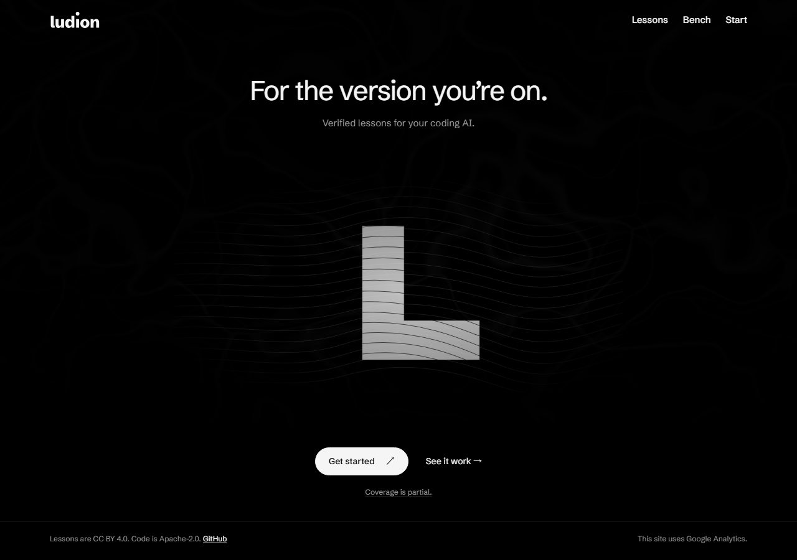

# Home brand scene — 2026-10-14

The owner asked for home to show Ludion, with technical information on separate pages. This is a concrete first design iteration for visual review, not a measured conversion improvement.

Home now has one short headline, a monochrome L-shaped refraction and native setup/evidence links. The actual answer comparison is at `/bench/#recorded-answer`; conditions, frozen scope, full answers and no-JavaScript access are unchanged. All lesson/subject/teacher/setup URLs remain. Partial coverage, lesson/code licenses and analytics disclosure remain visible. Home's prior `#replay` and `#recent` fragments remain on the outgoing evidence and coverage links.

The SVG is decorative brand art. It is not a verification replay or a claimed live product result. Its refraction shares the existing water clock, hidden-tab/offscreen pauses and reduced-motion still frame. Without JavaScript or WebGL, the static scene and native links remain complete. The home-only shader branch reduces background density; other pages keep their rendering settings. No dependency was added.

## Validation of final source

- Production build: 166 pages; sample build: 130 pages.
- Typecheck and `git diff --check`: pass.
- Unit tests: 456 pass in 27 files.
- Full Chromium suite: 23 pass in 2.2 minutes; only the optional screenshot capture is skipped in this run. Includes both-theme axe, page-wide reflow/canonicals, measured animated text contrast, canvas bounds/raster budget, Bench layout, clipboard/privacy disclosure, recorded comparison keyboard/no-JS/stable-height and wave/refraction stop/resume.
- Separate actual-page screenshot capture: 1 pass in 49 seconds, at 320/390/1280px in both themes.
- Sample axe: 2 pass in 20.3 seconds; optional sample video capture skipped.
- Home JavaScript measured by the browser test: 4.0 KB gzip, within the 60 KB limit.
- Independent visual review: the initial thin outline looked too diagrammatic; the current L face gives the scene a clear focal point. No visual blockers found in final light/dark desktop/mobile captures. This is an explicit first composition, not a completed brand identity; motion quality was not judged from still images.
- Independent source review: negative-base GLSL `pow` replaced by squared offsets; no remaining blockers found. No paid model runs, third-party images, lesson-code execution on this machine, or production operations.

Real-device GPU performance, visitor comprehension and conversion remain unmeasured. GitHub CI is reported separately on the PR.

## Actual local build captures

[Mobile dark](2026-10-14-home-showcase/home-390-dark.png) · [Mobile light](2026-10-14-home-showcase/home-390-light.png)
