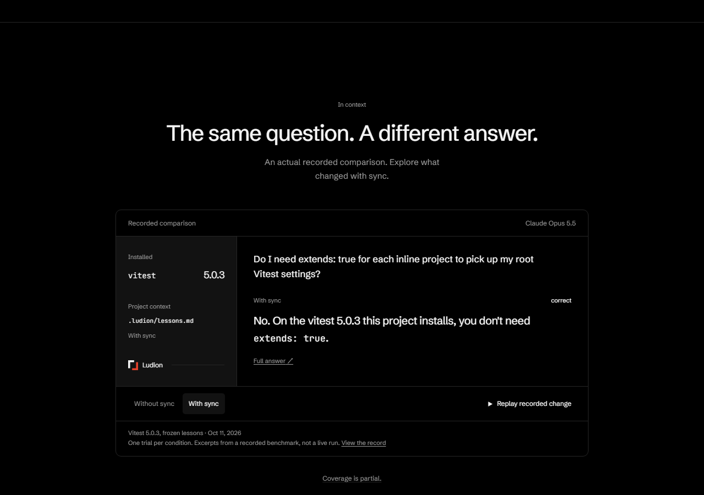

# Home: a visual opening, then a recorded interaction — 2026-10-14

Home establishes a visual scene before asking a visitor to read a technical result. The opening shows a short headline, an illustrated context surface and ordinary setup/scroll links. The next scene lets the visitor switch and replay two actual recorded answers. The last scene leads to setup. The arbitrary central L and first-viewport comparison have been removed.

The actual openings and following viewports of [Raycast](https://www.raycast.com/) and [Linear](https://linear.app/) were inspected for composition and the transition to product screens. No third-party code or artwork was copied. The supplied logo kit's Japanese bracket mark is used in the header and favicon, with a small vermillion brand accent. The service is still Ludion; the attachment's instructions and name placeholders were not adopted.

## Interaction and evidence boundaries

- The illustrated surface responds to a mouse pointer and aligns its layers as it scrolls away. A procedural SVG field carries slow light paths, above the existing wave extending to the page top. Scroll/pointer input schedules one paint; ambient CSS flow pauses offscreen or in a hidden tab. Reduced motion removes the flow/perspective and resets the input variables. Pointer input is decorative and does not gate any content.
- The surface's `vitest 5.0.3 → .ludion/lessons.md` and `extends` refer to `docs/demo/grep-output.txt`. This is explicitly an illustration, not a live verification, an invented product interface, a whole CLI output or evidence that a single lesson caused the recorded answer. File/version labels are readable at 16px desktop and 12px mobile. The 320px opening title is smaller to preserve space for the scene.
- The next scene uses literal excerpts from the pinned Done 3 question in `apps/site/src/build/home.ts`: the same question/model/project version, without and with sync. Grades, model, frozen lesson scope, date, full-answer URLs and the one-trial qualification remain. Replay animates a recorded change only; it never calls a model or runs a CLI.
- Switching conditions, a reduced-motion change or a hidden tab cancels a pending replay. `aria-disabled` and a handler guard prevent concurrent replay while preserving keyboard focus. Both answer panels reserve the same height. Without JavaScript, both answers remain visible and all ordinary links work.
- Setup, privacy, lessons, teacher attribution, agent-draft labels, generated claims and evidence scopes retain their URLs. The complete comparison also remains on `/bench/#recorded-answer`. Existing home `#replay` and `#recent` fragments still resolve. Partial coverage, licenses and analytics disclosure remain.
- Home's pool moved with the composition; the original bounds and shaded-pixel budget formulas are preserved, rather than claiming an identical lower screen coordinate. Other pages retain their wave settings.

## Validation

All of the following passed on the completed implementation:

- Site build: 166 pages; sample build: 130 pages. Typecheck and `git diff --check` pass.
- Full Chromium suite: 25 pass in 2.1 minutes, with the optional screenshot test skipped. Includes light/dark axe, page-wide reflow/canonicals, measured animated text contrast, canvas bounds/raster budget, keyboard/privacy/clipboard, recorded answers with and without JavaScript, stable panel height, replay focus and scroll/motion state.
- Separate capture test: 1 pass in 49 seconds; 132 actual-page screenshots at 320/390/1280px in both themes, including the full/reduced-motion home.
- Normal-motion opening and recorded scenes captured at those three widths in both themes: HTTP 200, no page errors or horizontal overflow. A desktop motion recording covers the opening, pointer movement, scrolling and recorded-answer replay.
- Sample axe: 2 pass in 19.8 seconds; optional sample design recording skipped.
- Core/worker/CLI/site-data unit suite: 456 pass in 27 files.
- Home JavaScript: 5.2 KB gzip across 5 files, within the existing 60 KB limit.
- Independent source review: no remaining blockers. Independent visual review at desktop/mobile in both themes found no clipping/overlap/readability blockers; its file/version legibility and 320px title findings were addressed. The underlying illustrated document is still a restrained composition, not evidence of a completed brand identity.

An initial light-theme check found the decorative red bracket text at 4.07:1: it was darkened and the measured check passed. A resume test sampled a very quiet corner where two WebGL frames could quantize to the same pixels; it now awaits the media-change state and samples a larger water-only region above the artwork. Four repeats and the final full suite passed. No animation freeze was inferred from identical corner pixels alone.

Final checks and capture receipts are recorded with this iteration. Real-device GPU performance, visitor comprehension, conversion and Raycast-level motion polish are not established by these browser tests or screenshots. This remains a design iteration on a draft PR, with a working local preview; production publication is not implied.

## Actual local build captures

These opening images use ordinary motion settings. They demonstrate composition, not animation quality. The local preview is the primary way to assess the motion. The reduced-motion layout and the full page are also checked separately.

[Mobile dark opening](2026-10-14-home-showcase/home-390-dark.png) · [Mobile light opening](2026-10-14-home-showcase/home-390-light.png)

[Recorded interaction in light](2026-10-14-home-showcase/recorded-1280-light.png)
