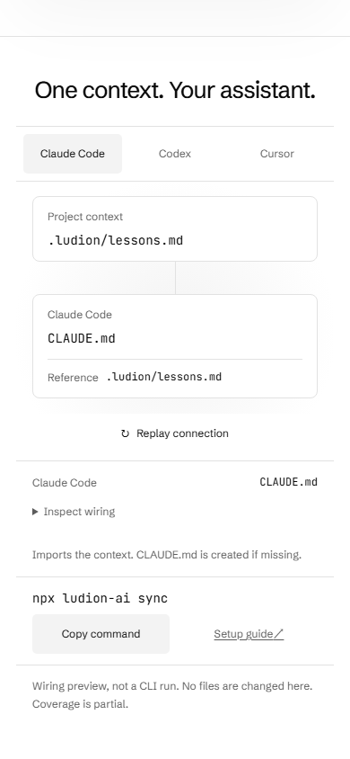

# Home composed for phones

The owner's request is to design phone proportions independently of desktop. The mobile homepage retains the same product evidence while changing its composition.

- Opening: a shorter context plane with the installed version above its output filename; ordinary phone height keeps the Explore control inside the opening viewport.
- Match: a bounded bent route with the same actual package population, version matching and measured pruning. Anonymous papers remain illustrations, not invented individual lesson claims.
- Inspect: compact configuration branches, native controls above content-sized panels, and unchanged generated claim, numeric teacher identity, draft attribution, evidence requirements and recorded context. Short landscape places metadata beside the comparison.
- Connect: native readable source/destination file surfaces, vertical on a phone and horizontal in short landscape. The same finite timeline carries the packet into either an actual reference or Cursor's inline context. Desktop retains CSS3D; its invisible scene is not rendered on compact screens.
- Controls: compact primary targets, wrapping navigation, native selects without reduced font size and a full selected-value readout only when the native single line clips. The exact option text remains unchanged.

No new strings, dependencies, accounts or production configuration were added. Full claims, privacy, coverage, source URLs and conditional file wiring remain accessible. The figures are illustrations rather than live sync, tests or model runs. The owner's independently merged desktop plane-angle change in #114 is preserved.

## Measured local checks

The machine-readable receipt is [validation.json](../bench/2026-10-15-home-mobile/validation.json). Its before/after geometry is measured at the same viewport, theme and reduced-motion settings. Heights below are rounded CSS pixels of the whole component, not timings or engagement measurements.

| Viewport | Match before → after | Inspect before → after | Delivery visual before → after |
| --- | --- | --- | --- |
| 320 × 667 | 917 → 737 | 884 → 682 | 260 → 258 |
| 390 × 844 | 939 → 737 | 826 → 691 | 260 → 258 |
| 844 × 390 | 679 → 525 | 859 → 486 | 410 → 160 |

The phone delivery surfaces deliberately use the available visual area rather than making their filenames tiny. At 768 × 1024 and 1280 × 900 the opening, Match, Inspect and delivery heights match the preceding build; the independently changed desktop perspective is retained. Actual captures are linked below; the receipt contains the complete geometry rather than only selected rounded values.

Regression checks cover real selection counts and unknown measurements, primary touch targets, diagram labels, native disclosures, keyboard focus through rotation, simulated 200% text-only resizing, native delivery movement and termination, reduced motion and existing evidence assertions. The text-size fixture doubles each computed font while keeping viewport and non-text dimensions fixed; it is not a real Safari accessibility setting or pinch gesture.

The initial targeted run found three failures in touch geometry, the rotation fixture's accessible selector and enlarged-text reflow. Those were corrected rather than accepted. Independent actual-screen review also found stretched landscape metadata rows; the final composition pins attribution to the top. Full browser, accessibility, typecheck, build, unit and capture results are in the receipt. An optional screenshot test is invoked separately.

The integrated local build produces 166 pages. Typecheck and 460 unit tests pass; the full browser suite passes 40 tests in 2.6 minutes with one optional screenshot skip. The separately invoked capture check produces 132 actual-page PNGs across both themes. The sample build produces 130 pages and passes both sample accessibility checks. Eight normal-motion profiles complete without page exceptions, bad assets or horizontal overflow; home JavaScript is 35.1 KB gzipped against the existing 60 KB limit. These counts and timings are copied from the receipt rather than estimates.

## Actual local captures

| Phone opening | Native delivery |
| --- | --- |
|  |  |

[Phone Match](2026-10-15-home-mobile/home-320-667-fit.png), [phone Inspect](2026-10-15-home-mobile/home-390-844-proof.png), [landscape Inspect](2026-10-15-home-mobile/home-844-390-proof.png), [desktop opening with the owner's angle change](2026-10-15-home-mobile/home-1280-900-opening.png).

## Release and limits

This document records the local implementation. Current-head CI and the sole deploy workflow must pass before the public result is claimed. Public verification joins the merged source SHA, deployment source SHA and exact live HTML/assets; public captures are retained with the user-facing report.

Real-device Safari, Android browser chrome, thermal behavior, GPU frame rate, visitor comprehension and conversion remain unmeasured. Browser viewport simulation is the evidence boundary.
